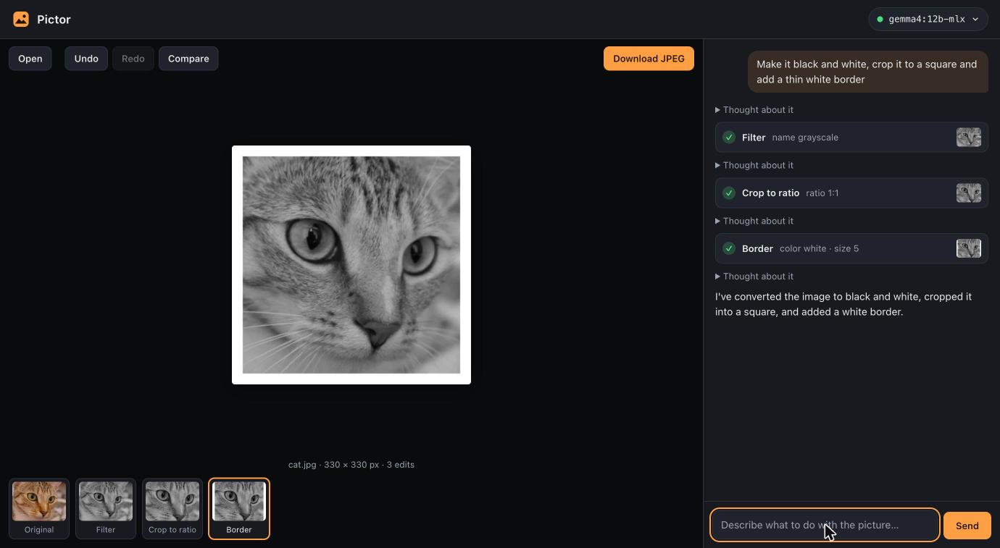

# Pictor

Choose a picture, say what you want done, and an AI model running **on your own computer** does it with image tools. Nothing is uploaded anywhere.



You write "make it black and white, crop it to a square and add a thin white border". The model looks at the picture, decides which tools to call, and you watch each step happen. Every step is kept as a version you can go back to.

## What you need

| | |
|---|---|
| **[Ollama](https://ollama.com/download)** | The one program to download. It is free, open source (MIT) and runs the AI model on your machine. Install it and start it. |
| **[uv](https://docs.astral.sh/uv/)** | Runs the app and fetches Python and the libraries for you. |
| A reasonably recent computer | Apple Silicon Mac, a PC with an NVIDIA or AMD graphics card, or just a CPU with 8 GB of RAM or more. |

Pictor itself is Python only. The interface is a small web page bundled in the package and served locally, so there is no Node.js and no build step.

## Start

```bash
git clone https://github.com/JureZajc/pictor
cd pictor
uv run pictor
```

Your browser opens at `http://127.0.0.1:8765`. Without cloning:

```bash
uvx --from git+https://github.com/JureZajc/pictor pictor
```

## First start: the model is chosen for your machine

On first start Pictor looks at your computer and picks the largest model that fits:

1. It reads the CPU, the memory and the graphics card's memory.
2. It works out a memory budget: 70% of memory on Apple Silicon (the CPU and GPU share it), 95% of video memory on a PC with a graphics card, and at most 8 GB on a CPU-only machine, where speed is the limit.
3. It offers the largest model from its list that fits the budget, already selected. One click downloads it through Ollama and you are ready. You can pick any other model instead.

What that means in practice:

| Machine | Budget | Model chosen | Download |
|---|---|---|---|
| Mac with 8 GB | 5.6 GB | `qwen3.5:2b-mlx` | 3.1 GB |
| Mac with 16 or 24 GB | 11.2 / 16.8 GB | `gemma4:12b-mlx` | 7.7 GB |
| Mac with 32 GB | 22.4 GB | `gemma4:26b` | 16 GB |
| Mac with 48 GB or more | 33.6 GB | `qwen3.6:35b-mlx` | 23 GB |
| PC with a 6 GB card | 5.7 GB | `qwen3.5:2b` | 2.7 GB |
| PC with an 8 GB card | 7.6 GB | `qwen3.5:4b` | 3.3 GB |
| PC with a 12 or 16 GB card | 11.4 / 15.2 GB | `gemma4:12b` | 7.7 GB |
| PC with a 24 GB card | 22.8 GB | `gemma4:26b` | 16 GB |
| PC with a 32 GB card | 30.4 GB | `qwen3.6:35b` | 23 GB |
| No graphics card, 8 GB RAM | 4 GB | `qwen3.5:0.8b` | 1.2 GB |
| No graphics card, 16 GB RAM or more | 8 GB | `qwen3.5:4b` | 3.3 GB |

A model needs more memory than its download size, because the picture, the tool list and the conversation take room too. Pictor estimates `download × 1.2 + 1.8 GB`, calibrated on a real run where a 7.7 GB model peaked at 11.1 GB.

A model you already have in Ollama is preferred when it is nearly as good as the best download. On Apple Silicon, Ollama's MLX builds are used when they fit. Models must support tool calling; one that cannot see pictures still works but edits blind.

To see what Pictor detects and would choose, without starting the app:

```bash
uv run pictor doctor
```

Change the model later by clicking its name in the top right corner.

## Using it

1. **Choose a picture**: click, drag it in, or paste from the clipboard. JPEG, PNG, WebP, HEIC, GIF, BMP and TIFF work.
2. **Say what to do**, in your own words and your own language. Some examples:
   - "Remove the background"
   - "Blur all the faces"
   - "Crop to 16:9 keeping the top, then make it 1920 pixels wide"
   - "Make it warmer and a bit brighter"
   - "Write 'Summer 2026' in the bottom right corner in yellow"
   - "Blur the background like a portrait photo"
   - "What is in this picture?"
3. **Watch the steps.** Each tool call appears in the conversation; click one to see exactly what was called.
4. **Undo, compare, download.** Every edit is a version in the strip under the picture. Hold *Compare* to see the original. *Download* saves the current version.

The conversation is remembered, so "actually undo that and add a border instead" works.

## What the model can do

| Tool | What it does |
|---|---|
| Crop, crop to ratio | Cut to a region or to an aspect ratio such as 1:1 or 16:9 |
| Resize | By percent, or to a width and height (fit, fill or stretch) |
| Rotate, flip | Any angle, optionally trimming the empty corners |
| Border, pad to ratio | Add a frame, or reach an aspect ratio without cropping |
| Adjust | Brightness, contrast, saturation, sharpness, warmth |
| Filter | Grayscale, sepia, invert, blur, sharpen, vintage, posterize, pixelate, vignette, sketch, emboss |
| Auto enhance | One-step fix for a dull photo |
| Blur region | Blur or pixelate a rectangle or ellipse |
| Detect faces, anonymize faces | Find faces and blur or pixelate them |
| Remove background | Cut out the subject, leaving transparency |
| Change background | Solid colour, blur, black and white, or darken, keeping the subject |
| Add text, draw shape | Captions and outline boxes or ellipses |
| Inspect, look | Read the picture's facts, or look at it again after an edit |
| Output format | Save as PNG, JPEG or WebP |
| Undo, reset | The model can take back its own mistakes |

It cannot generate new content. It will not paint in something that is not there or erase an object and invent what was behind it, and it says so when asked.

## What gets downloaded, and where

Everything below is open source and stays on your machine.

| What | Size | When | Where |
|---|---|---|---|
| The AI model | 1 to 23 GB, see the table above | First start, after you confirm | Ollama's model folder |
| Background model (IS-Net, through [rembg](https://github.com/danielgatis/rembg)) | 180 MB | First time a background tool runs | `~/.rembg` |
| Face detector ([YuNet](https://github.com/opencv/opencv_zoo/tree/main/models/face_detection_yunet), MIT) | 230 KB | First time a face tool runs | Pictor's cache folder |

Each AI model has its own licence, shown on its page in the [Ollama library](https://ollama.com/library). After these downloads Pictor works offline.

## Settings

`uv run pictor doctor` prints where the settings file is. It is JSON:

| Key | Default | Meaning |
|---|---|---|
| `model` | chosen on first start | Ollama tag of the model |
| `think` | `"auto"` | `"auto"` keeps reasoning brief when the model allows it, `"off"` is fastest, `"default"` leaves the model's own setting |
| `num_ctx` | from the memory budget | Context window in tokens (8192 to 16384) |
| `vision_max_side` | `1024` | Longest side of the copy of the picture the model looks at |
| `max_steps` | `12` | Most tool rounds for one instruction |
| `background_model` | `"isnet-general-use"` | Any [rembg model name](https://github.com/danielgatis/rembg#models) |
| `ollama_host` | `OLLAMA_HOST` or port 11434 | Where Ollama listens |

Command line:

```
pictor [run|doctor] [--port 8765] [--host 127.0.0.1] [--model TAG] [--no-browser]
```

Environment: `OLLAMA_HOST` points at another Ollama server, `PICTOR_HOME` keeps settings and cache in a folder of your choice.

### Updating the model list

Local models change quickly. The list Pictor recommends from is data, in [`src/pictor/data/models.json`](src/pictor/data/models.json), last updated 2026-11-22 from the [Ollama library](https://ollama.com/search?c=vision&c=tools). To use your own list, put a `models.json` of the same shape next to the settings file. You can also type any Ollama tag under *More options* in the model dialog.

The tiers in that list are ordered by model size, not by a benchmark of how well each model edits pictures.

## Privacy and safety

- The model, the tools and the pictures all stay on your computer.
- The server listens on `127.0.0.1` only and refuses requests that come from other websites.
- The model's tools can only change the picture you opened. They cannot read or write other files, run commands or reach the network.
- Working copies live in Pictor's cache folder and are cleared out on a later start, once they are a day old.

## Limits worth knowing

- **Tested on one machine.** Everything here was run on an Apple Silicon Mac with 24 GB of memory, Ollama 0.40.16 and `gemma4:12b-mlx`, where a two-step edit (black and white, then a square crop) took 14 seconds. The graphics card detection for Windows and Linux is covered by unit tests but has not been run on real hardware.
- **Small models make mistakes.** Below about 9B parameters, expect wrong tools or clumsy coordinates. Undo is one click.
- **Positions are approximate.** The model estimates regions by eye, as percentages of the picture.
- **A model that does not fit will not run well.** On that 24 GB Mac an 18 GB model failed with an out-of-memory error from Ollama. Pictor marks such models "Too large" and explains the failure if you pick one anyway.

## Development

```bash
uv sync
uv run pytest          # needs neither Ollama nor a network connection
uv run ruff check .
uv run ruff format .
```

| Path | What is there |
|---|---|
| `src/pictor/hardware.py` | CPU, memory and GPU detection, and the memory budget |
| `src/pictor/catalog.py`, `data/models.json` | The model list and the rule that picks one |
| `src/pictor/ollama.py` | Client for Ollama's HTTP API |
| `src/pictor/agent.py` | The loop: show the picture, run tool calls, feed results back |
| `src/pictor/tools/` | The tools, one plain function each |
| `src/pictor/session.py` | A picture's versions, undo history and export |
| `src/pictor/server.py` | Local web server and JSON API |
| `src/pictor/static/` | The interface: HTML, CSS and one JavaScript file |

### Adding a tool

A tool is a function in `src/pictor/tools/`. The docstring is what the model reads, so write it for the model:

```python
from typing import Annotated

from PIL import Image, ImageOps

from pictor.tools.registry import P, ToolContext, ToolResult, tool


@tool("Mirror tile")
def mirror_tile(
    ctx: ToolContext,
    copies: Annotated[float, P("How many copies side by side", 2, 6)] = 2,
) -> ToolResult:
    """Repeat the picture side by side, mirroring every second copy."""
    image = ctx.image
    count = max(2, min(6, round(copies)))
    result = Image.new(image.mode, (image.width * count, image.height))
    for index in range(count):
        tile = ImageOps.mirror(image) if index % 2 else image
        result.paste(tile, (index * image.width, 0))
    return ToolResult(f"Tiled the picture {count} times.", result, detail=f"{count}×")
```

Import the module in `src/pictor/tools/__init__.py` and the model can call it. Returning an image creates a new version; returning only a message leaves the picture alone.

## Licence

MIT. See [LICENSE](LICENSE).
